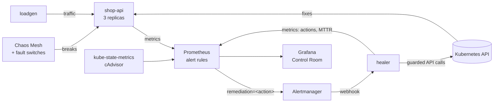

# Self-Healing Kubernetes

> Chaos in, recovery out. A Kubernetes lab where failures are injected on purpose and fixed automatically, with guardrails, measured MTTR, and a CI job that proves it works.

Kubernetes already heals the easy stuff: a killed pod gets replaced. This project covers the failures it **doesn't** fix on its own, which are the ones that page humans at 3 a.m.:

| Failure (injected)          | Why Kubernetes alone doesn't fix it                | Detected by                 | Automated fix                         |
| --------------------------- | -------------------------------------------------- | --------------------------- | ------------------------------------- |
| Pod deadlocks (stuck unready) | Readiness failures never restart a pod           | `PodStuckNotReady`          | Delete the pod → fresh replacement    |
| Memory leak                 | It waits for the OOM killer, mid-request           | `PodMemoryNearLimit` (>80%) | Recycle the pod gracefully, pre-OOM   |
| Bad release (50% errors)    | The rollout "succeeds": probes are green          | `HighErrorRate` (>20% 5xx)  | Roll back to the previous revision    |
| CPU saturation              | No HPA, or it isn't fast enough                    | `HighLatencyP95` (>250 ms)  | Scale up, capped per workload         |
| Worker node dies            | Pods wait out a **5-minute** default toleration   | `NodeNotReady`              | Cordon + evict in ~2 min, uncordon on recovery |
| Random pod kill (baseline)  | It *does* fix this one                             | none                        | None: the healer must stay out of the way |

## Architecture



**The contract is a label.** Every alert rule that has a fix carries a `remediation` label (`delete-pod`, `rollback`, `scale-up`, `cordon-drain`). Alertmanager routes only those alerts to the healer, and the label's value picks the runbook. Adding a new auto-fix means adding one alert rule and one planner function.

## Guardrails: the part that makes it production-minded

An automated fixer that goes wrong can do more damage than the original outage. The healer is built defensively ([engine.py](healer/healer/engine.py)):

- **Opt-in only**: it only touches Deployments annotated `healer.io/enabled: "true"`, in allow-listed namespaces.
- **Cooldowns**: there's a cooldown per Deployment, not per pod, so a fleet-wide fault can't delete every pod at once. Rollbacks get a longer cooldown (10 min) so the healer never flips straight back to the bad revision while the old alert drains.
- **Action budget / circuit breaker**: after 10 actions in 10 min, the healer stops and surfaces `healer_circuit_open=1`. If it keeps acting, the problem isn't one it can fix, and a human needs to look.
- **Blast-radius limits**: it never drains a control-plane node, cordons at most one node at a time, respects PodDisruptionBudgets (it uses the Eviction API), never fights an HPA, and never scales past `healer.io/max-replicas`.
- **It doesn't live on what it heals**: the healer and the whole monitoring stack are pinned to the control-plane node, so a worker failure can't take out its own detector.
- **Dry-run mode** (`DRY_RUN=true`) logs every decision without acting, so you can roll it out safely.
- **Least-privilege RBAC** ([rbac.yaml](deploy/healer/rbac.yaml)) grants exactly the verbs the four runbooks need.
- **Audit trail**: every action writes a Kubernetes Event (`kubectl get events -A | grep SelfHealed`) and a log line.

## Quick start

**Needs:** Docker Desktop (running), about 8 GB of RAM free. `kind`, `helm` and `kubectl` are installed automatically on Windows via winget.

```powershell
./scripts/up.ps1        # Windows: creates the cluster and installs everything (~5-8 min)
```

```bash
make up                 # macOS / Linux equivalent
```

Then open:

| What         | URL                                              |
| ------------ | ------------------------------------------------ |
| Grafana      | http://localhost:3000/d/self-healing (admin/admin) |
| Prometheus   | http://localhost:9090/alerts                     |
| Alertmanager | http://localhost:9093                            |
| shop-api     | http://localhost:8080/api/products               |

## Run the demo

```powershell
./scripts/demo.ps1 bad-release    # ship v2 with 50% errors, then watch it get rolled back
./scripts/demo.ps1 unready        # deadlock one pod
./scripts/demo.ps1 leak           # start a memory leak
./scripts/demo.ps1 cpu-stress     # Chaos Mesh CPU burn -> latency -> scale-up
./scripts/demo.ps1 node-failure   # stop a worker node's container
./scripts/demo.ps1 pod-kill       # baseline chaos Kubernetes handles alone
./scripts/demo.ps1 status         # nodes, pods, last healer decisions
./scripts/demo.ps1 reset          # undo all chaos
```

Each scenario prints what breaks, what should fire, and what the healer should do. Follow along with:

```bash
kubectl -n healer logs -f deployment/healer
```

```
HighErrorRate rollback on shop/shop-api -> success (rolled back from revision 2 to 1)
HighErrorRate rollback on shop/shop-api -> resolved (recovered in 104s)
```

Tear down with `./scripts/down.ps1` or `make down`.

## Measuring it

The healer exports its own SLO metrics, which the **Self-Healing Control Room** dashboard plots:

- `healer_recovery_seconds`: alert start → alert resolved, for alerts the healer acted on. This is **MTTR**.
- `healer_remediations_total{action,result}`: success, failed, dry_run, skipped_cooldown, skipped_budget, skipped_policy.
- `healer_circuit_open`: whether the healer has stopped and handed over to a human.
- Availability: the 5xx ratio of real traffic from `loadgen`.

Record your own numbers after a run and put them here. Concrete results are what make this project stand out:

| Scenario      | MTTR without healer | MTTR with healer | Availability during |
| ------------- | ------------------- | ---------------- | ------------------- |
| bad-release   | ∞ (until a human)   | _fill in_        | _fill in_           |
| node-failure  | ~5–6 min            | _fill in_        | _fill in_           |
| unready pod   | ∞ (stays stuck)     | _fill in_        | _fill in_           |

## Proven in CI

[`.github/workflows/ci.yaml`](.github/workflows/ci.yaml) runs three jobs:

1. **unit**: runs the healer's engine tests (policy, cooldowns, budget, dry-run, MTTR) against a fake Kubernetes API.
2. **manifests**: validates every manifest and CRD with `kubeconform`.
3. **e2e**: spins up kind with Prometheus, ships a bad release, and **fails the build unless the healer rolls it back by itself** ([e2e.sh](scripts/e2e.sh)).

Run the unit tests locally:

```bash
cd healer && pip install -r requirements.txt -r requirements-dev.txt && python -m pytest -q
```

## Repo layout

```
app/                 shop-api: stdlib-only Python service with fault switches + Prometheus metrics
healer/              the remediation controller (Alertmanager webhook -> guarded K8s actions)
  healer/engine.py   policy + decision logic (pure, unit-tested)
  healer/kube.py     every Kubernetes API call lives here
deploy/app/          shop-api Deployment, PDB, ServiceMonitor, load generator
deploy/healer/       healer Deployment, least-privilege RBAC
deploy/monitoring/   alert rules (symptom -> runbook) + Grafana dashboard
helm-values/         kube-prometheus-stack and Chaos Mesh config
chaos/               Chaos Mesh experiments
cluster/             kind cluster definition
scripts/             up / demo / down (PowerShell), e2e (bash)
```

## How I'd take it further

- Replace the webhook with a real **operator** (kopf or controller-runtime) and a `RemediationPolicy` CRD, so runbooks become declarative.
- **GitOps-aware rollback**: when Argo CD owns the Deployment, revert the Git commit instead of patching the cluster, which would otherwise drift.
- Run Chaos Mesh **Workflows** as a scheduled "game day" and alert if MTTR regresses.
- Use an LLM to summarise each incident into a Slack post (combine with project idea #3).

## Interview story (STAR)

> **Situation:** Kubernetes restarts crashed pods, but most real incidents (bad deploys, leaks, hung pods, dead nodes) still need a human.
> **Task:** Automate the fix for the failures the platform *doesn't* handle, without creating a robot that makes outages worse.
> **Action:** I built an Alertmanager-driven remediation controller with four runbooks. I added guardrails: opt-in, cooldowns, an action budget with a circuit breaker, PDB-respecting evictions, dry-run, and least-privilege RBAC. I proved it with Chaos Mesh and a CI job that ships a bad release and fails unless the system rolls itself back.
> **Result:** Bad releases roll back in about 2 minutes instead of waiting for a human, and node failures recover about 3 minutes faster than Kubernetes' default. Every action is auditable and measured as MTTR on a dashboard. *(Replace these with your measured numbers.)*
